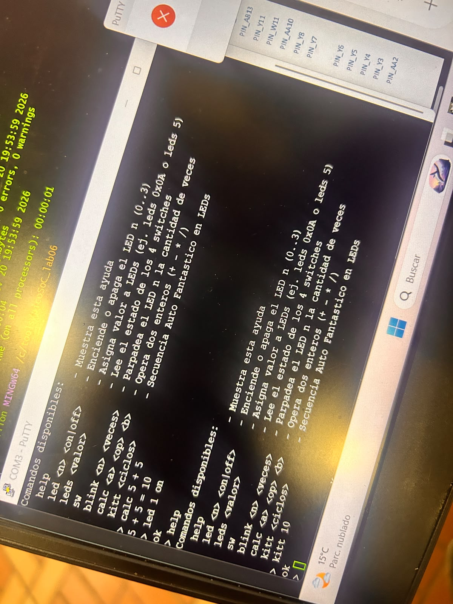

# Lab06: Implementación de SoC basado en RISC-V (PicoSoC) y Periféricos en FPGA DE10-Lite

## Integrantes
- [Edwin Albeiro Blanco](https://github.com/Edwinal05)
- [Cristian David Maldonado](https://github.com/CristianMaldonadoTinjaca)
- [Anderson Stiven Malagon](https://github.com/andersonstmalagonal-svg)

---

## Tabla de Contenidos
1. [Documentación](#1-documentación)
   - [picorv32](picorv32.v)
   - [picosoc_noflash](picosoc_noflash.v)
   - [simpleuart](simpleuart.v)
   - [progmem](progmem.v)
   - [main.c](main.c)
   - [start.s y sections.lds](start.s)
   - [Makefile y progmem.py](Makefile)
2. [Mapa de Memoria y Arquitectura](#2-mapa-de-memoria-y-arquitectura)
3. [Evidencias de implementación](#3-evidencias-de-implementación)
4. [Preguntas](#4-preguntas)
5. [Conclusiones](#5-conclusiones)
6. [Referencias](#6-referencias)

---

## 1. Documentación :

En esta sección se describe la arquitectura hardware/software del sistema en chip (SoC) y los enlaces a los archivos que componen el proyecto en el repositorio:

- **[picorv32.v](picorv32.v):** Núcleo procesador de 32 bits basado en la arquitectura abierta **RISC-V (RV32I)** optimizado para bajo consumo de área en FPGA.
- **[picosoc_noflash.v](picosoc_noflash.v):** Módulo de integración del SoC sin memoria Flash externa; interconecta el procesador `picorv32`, la memoria interna (`progmem`), el controlador UART y el bus de periféricos externos (*IOMem*).
- **[simpleuart.v](simpleuart.v):** Periférico de comunicación serial asíncrona (UART) con divisor de reloj configurable para transmisión y recepción de datos.
- **[progmem.v](progmem.v):** Memoria RAM/ROM sintetizable en bloques internos de la FPGA donde se almacena el programa compilado y los datos de ejecución.
- **[main.c](main.c):** Código fuente en lenguaje C (*bare-metal*, sin librerías estándar) que gestiona la comunicación serial, el control de los LEDs y la lectura de los switches.
- **[start.s](start.s) / [sections.lds](sections.lds):** Rutina de arranque en ensamblador RISC-V (inicialización de pila y registros) y *linker script* que define la distribución de memoria del firmware.
- **[Makefile](Makefile) / [progmem.py](progmem.py):** Automatización de la compilación cruzada (`riscv-none-elf-gcc`) para generar el binario (`main.bin`) y convertirlo al formato legible por Verilog (`progmem.v`).

---

## 2. Mapa de Memoria y Arquitectura :

El sistema opera con el reloj principal de la tarjeta **DE10-Lite a 50 MHz**. Para la comunicación serial a **115200 baudios**, se configura el divisor de reloj del periférico UART mediante la relación:

$$\text{CLKDIV} = \frac{50\,000\,000}{115200} \approx 434$$

### Distribución de Direcciones (Memory-Mapped I/O)

El procesador se comunica con los periféricos escribiendo y leyendo directamente sobre direcciones específicas de memoria mediante punteros volátiles (`volatile uint32_t*`):

| Periférico | Dirección Base | Tipo de Acceso | Función en el Sistema |
| :--- | :---: | :---: | :--- |
| **Memoria de Programa (`progmem`)** | `0x00000000` | Lectura / Escritura | Almacena las instrucciones y variables del firmware |
| **UART Clock Divider** | `0x02000004` | Lectura / Escritura | Configura la tasa de baudios (`434` para 115200 bps) |
| **UART Data** | `0x02000008` | Lectura / Escritura | Envía o recibe caracteres ASCII por puerto serial |
| **LEDs (Salida)** | `0x03000000` | Escritura | Controla el estado lógico de los LEDs de la FPGA |
| **Switches (Entrada)** | `0x03000004` | Lectura | Lee la posición física de los interruptores de la tarjeta |

---

## 3. Evidencias de implementación :

Sintetizamos el proyecto completo en Quartus (`top.qpf`) y compilamos el firmware mediante el `Makefile` para verificar el funcionamiento del procesador en la tarjeta DE10-Lite:

| Esquemático RTL del SoC | Consola Serial UART / Pruebas en FPGA |
| :---: | :---: |
|  

---

## 4. Preguntas :

1. **¿Qué significa que el código en `main.c` sea *bare-metal* y por qué se usa el calificador `volatile` en los punteros?**
   - Un programa *bare-metal* se ejecuta directamente sobre el hardware sin un sistema operativo intermedio ni librerías estándar (`libc`), por lo que debemos programar manualmente funciones básicas como `uart_putchar` y configurar el arranque en `start.s`. El calificador `volatile` evita que el compilador optimice o elimine lecturas/escrituras hacia las direcciones de los periféricos (`0x02000008`, `0x03000000`, etc.), garantizando que cada instrucción acceda realmente al bus de hardware.

2. **¿Cómo funciona la comunicación entre el código C y los módulos en Verilog (`top.v` / `picosoc_noflash.v`)?**
   - Mediante **Entrada/Salida Mapeada en Memoria (MMIO)**. Cuando el procesador ejecuta una instrucción de almacenamiento (`sw`) o carga (`lw`) en direcciones fuera de la RAM (`>= 0x02000000`), el